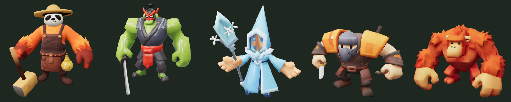
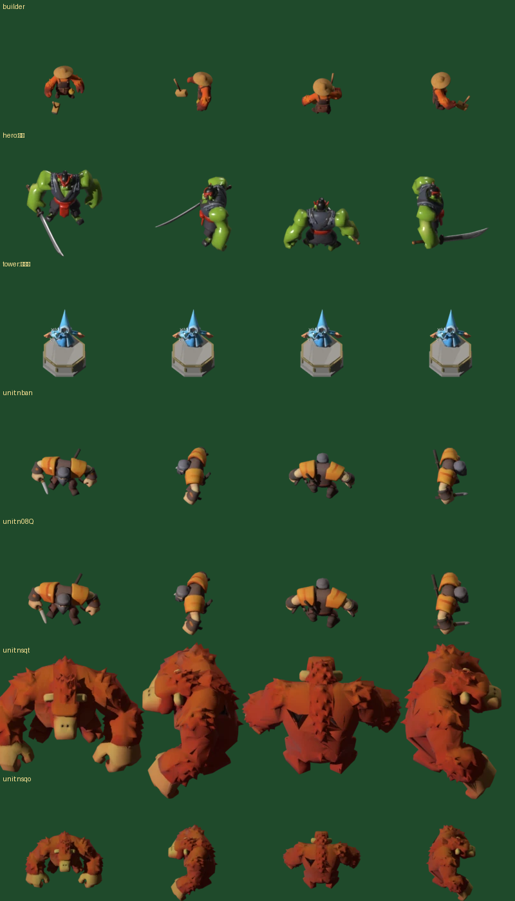

# 试做结果（2026-10-15，Tripo 生成）

## 做了什么
| | 守卫者 | 剑神 | 冰霜塔 | 强盗 | 大红牛 |
|---|---|---|---|---|---|
| Tripo 生成（P1 低模 + 贴图） | ✅ | ✅ | ✅ | ✅ | ✅ |
| 自动绑骨（biped） | ✅ | ✅ | ✅ | ✅ | ✅ |
| 套预设动作 | ❌ | ❌ | ❌ | ❌ | ❌ |
| 修整 / 出图 / 登记 | ✅ | ✅ | ✅ | ✅ + 变体 | ✅ + 变体 |
| 面数 | 5962 | 11395 | 5802 | 2966 | 11893 |

**积分：** 5 × 65 = 325（生成 40 + 绑骨 25）。套动作失败的任务全部自动退款。余额 1635。

## 画风结论（待你确认）
- **统一性好**：5 个都是"厚重夸张的卡通低模 + 手绘贴图"，饱和度和笔触一致，可以直接作为样板。
- **可读性好**：强盗的橙色护甲、剑神的绿皮红腰带、大红牛的红橙毛色，在游戏缩放下都能一眼认出。
- **需要调整：**
  1. 冰霜塔：女巫在塔座上偏小，下次把角色身高从 1.7 m 调到 2.0 m。
  2. 守卫者：可以略放大（1.6 → 1.8 m），让它在地图上更显眼。
  3. 两个变体（强壮的强盗、小红牛）只做了缩放和染色，和原型几乎看不出区别。需要人工加配件，或者直接用 Tripo 单独生成。

## 发现并已修复的问题
1. Tripo 绑骨输出的 GLB 里带一个 2 米的辅助球体，导致身高量错。现在自动修整脚本会删掉没绑到骨架上的网格。
2. Tripo 绑骨输出的角色面朝 +X（规范是 -Y）。现在 `tripo_trial.py` 会自动写入 `rotate=-90`。

## 未解决：动作
`tripo anim retarget` 对这 5 个绑骨任务一律返回 **1004 参数无效**。已经试过的组合：
- v2.5 的动作名（如 `preset:walk`）和 v1.0 的动作名（如 `preset:biped:walk`）
- 单个动作和多个动作
- 带和不带 `out_format`、带和不带"原地播放"

结果都一样。绑骨任务的记录里只有 `topology: biped`，没有骨骼版本，怀疑是 P1 模型的绑骨和动作接口不兼容。

### 方案 B 验证结果（v3.1 重新生成强盗）：失败
| 尝试 | 结果 |
|---|---|
| v3.1 生成 + 绑骨 | ✅ 55 积分（生成 30 + 绑骨 25） |
| 套 walk + fall（原地） | ❌ 1004 |
| 重新绑骨，显式指定 `spec=tripo`、`out_format=glb`（25 积分），再套 walk | ❌ 1004 |
| 直接调用老的 v2 接口（`api.tripo3d.ai/v2/openapi/task`）套 walk / idle / run / biped:walk | ❌ 全部 1004 |

**结论：** 不管上游是 P1 还是 v3.1，不管用 CLI 还是 v2 接口、用什么动作名，这个账号的套动作任务都在服务器端失败。这是 Tripo 侧的问题，所有失败的任务都已自动退款。本轮共花 80 积分，余额 1555。

**画风对比**（[试做对比_P1与v3.1.png](试做对比_P1与v3.1.png)）：P1 更卡通、颜色更亮、武器清楚；v3.1 细节多但偏暗、短刀丢失。**模型继续用 P1。**

### 剩下的方案
- **A. 向 Tripo 反馈。** 附上任务 ID：绑骨 `d50fe768-76ae-4d3a-8ad5-e6172cc016e5`，失败的套动作任务 `5bcfdc68-a3a0-474e-ab2e-46b558a70a5b`、`ba6f90b9-703a-4d55-8f5e-017738ee2b04`。修好后，`tripo_trial.py` 重跑就会自动补上动作。
- **C. Mixamo。** 把模型上传到 Mixamo，重新绑骨并套动作。免费、质量好，但每个模型要人工操作约 10 分钟，76 个模型约 13 小时。
- **D. 在 Blender 里程序化生成动作（我来写脚本）。** Tripo 绑好的骨架有规律的骨骼名（脊柱、头、四肢链），可以按位置自动识别手臂和腿，再用脚本生成行走、待机、攻击、死亡、施法的关键帧。全自动、零成本，接进现有流水线。动作会比较"机械"，但在游戏里 30–60 px 大小下基本够用，以后也可以逐个换成 Mixamo 的动作。

### 方案 D：程序化动作（已采用，2026-10-16）
`tools/blender/procedural_anim.py`：在 Tripo 绑好的骨架上，用脚本生成 idle / walk / attack / death / spell / build 的关键帧。已接入 `tools/process_incoming.py`，修整之后自动执行（已有的同名动作会保留，以后有 Mixamo 或 Tripo 的正式动作可以直接替换）。

**骨架识别不看骨骼名**（Tripo 有的模型命名是乱的，守卫者的脊柱就叫 `0_Left_Limb_*`）：
1. 躯干：根骨骼到最高、居中的末端骨骼之间的路径。
2. 肢体：从躯干分出去的长分支，沿最长子链走（手指分叉时取最长那支）。一根髋骨下挂两条腿的情况会拆开。
3. 挂得最低的两条是腿，挂在较高处、分在左右两侧的是手臂。接近水平的锁骨 / 髋骨会跳过。

5 个试做模型全部识别正确（各 2 条腿、2 条手臂）。

**结果：** 7 个模型（含 2 个变体）全部带动作出图，验收无 ❌，在游戏里正常播放。精灵表共 2.6 MB（WebP）。

| 模型 | 动作 | 效果 |
|---|---|---|
| 守卫者 | 待机 / 行走 / 敲锤 | ✅ 锤子跟着右手走（已由自动道具修正处理，见下方） |
| 剑神 | 待机 / 攻击 / 施法 | 举刀过头再劈下；施法时双手高举再前推 |
| 冰霜塔 | 待机 / 攻击 | ✅ 角色调到 2 m；法杖和顶上的雪花装饰一起跟着右手走 |
| 强盗 | 行走 / 死亡 | 腿和手臂交替摆动，倒地后躺平 |
| 大红牛 | 行走 / 死亡 / 施法 | 正常；施法是捶胸怒吼 |

**出图脚本的配套改进：**
- 被裁切时按被裁的边调整：只裁底边 / 顶边就挪脚底锚点；上下都裁过或左右被裁才放大画布。锚点写进帧信息，游戏按它对齐。
- BOSS 用每米 24 像素出图（普通单位 40），游戏里显示大小不变，图小很多。
- 死亡时身体边倒边往前挪半个身长，躺平的身体以原站立点为中心，画布不需要是身高的两倍。
- 验收改在静止姿势下测量，动作里的起伏不影响结果。

**动作的局限：** 程序化动作比较"机械"，在游戏里 30–60 px 大小下够用。重要单位（英雄、BOSS）以后可以逐个换成 Mixamo 动作：放进 `art/incoming/<文件夹>/anims/` 重跑即可，同名动作会自动替换。

### 试做问题修复（2026-10-16）
1. **冰霜塔角色调到 2 m。** 塔类的默认角色身高（`prep_model.py`）一起改成 2 m，后面 27 种塔都会沿用。
2. **手持道具自动改绑到手上**（`procedural_anim.py` 里的"道具修正"，每个模型生成动作前自动执行）。

   AI 绑骨常把武器、工具绑错骨骼。试做里遇到两种：
   - 守卫者的锤子绑在了右腿上。
   - 冰霜塔的法杖被单独长了一根挂在脊柱上的小骨骼。

   规则：
   - 只处理"刚性绑定"的部件，即一半以上权重集中在同一根骨骼上。裤子、衣摆这类权重分散的不动。
   - 绑在手臂或头上的不动；位于肩膀以上、左右居中的（帽子、兜帽）也不动。
   - 绑在腿或躯干上的，只有伸出身体主体之外才算道具（锤子）。
   - 绑在不属于任何肢体的独立小骨骼上的，算道具（法杖）。同一根骨骼上的其它部件（法杖顶的雪花）一起改绑。
   - 道具改绑到最近那只手的末端骨骼上。

   5 个模型的结果：守卫者改绑 2 块（锤头、锤柄），冰霜塔改绑 6 块（法杖和雪花装饰）。剑神、强盗、大红牛无改动，没有误伤。
